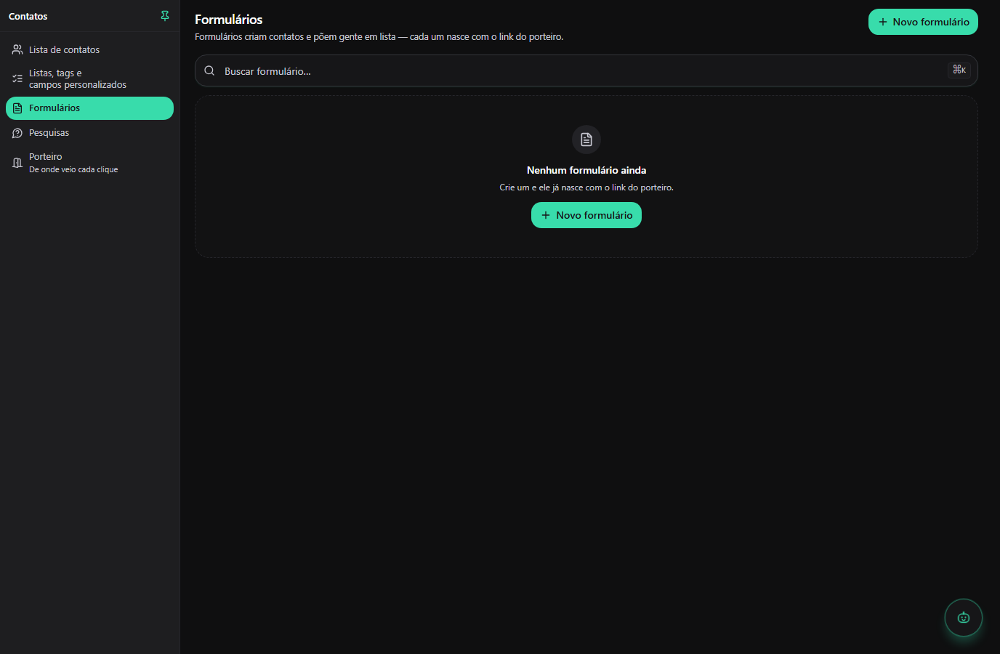
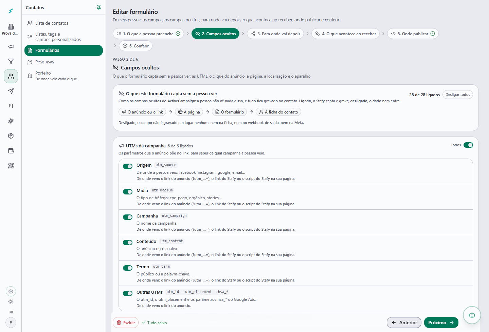
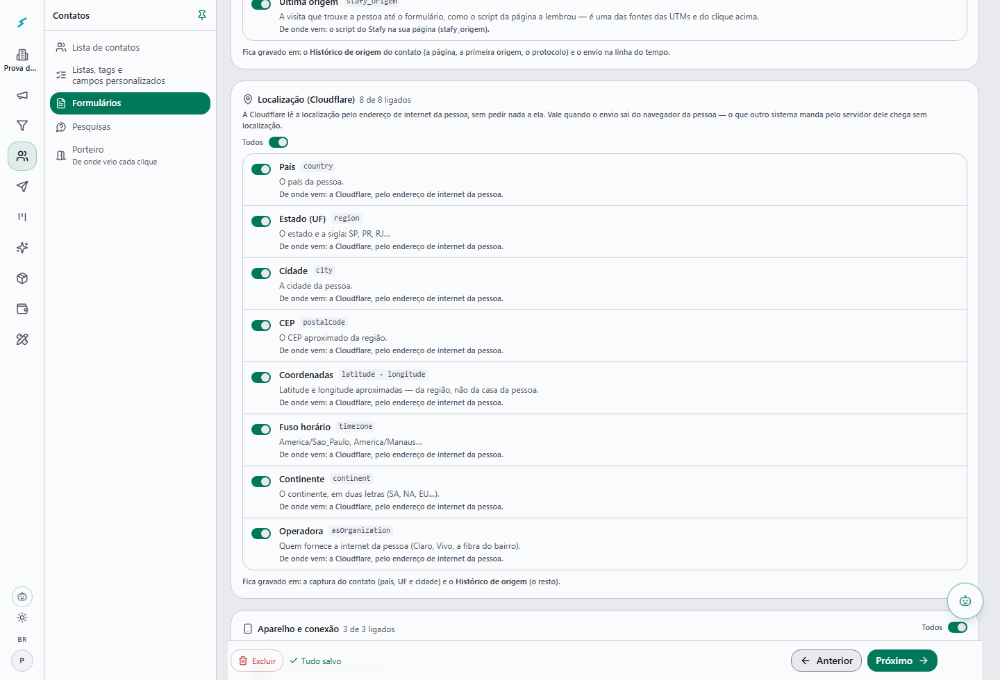
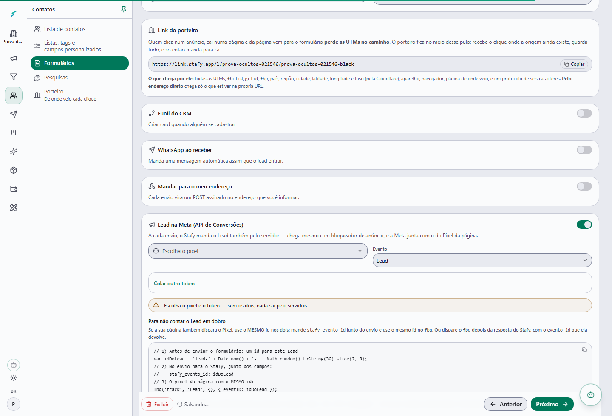
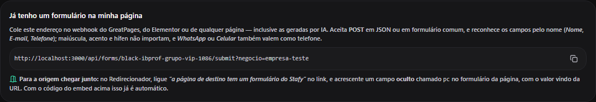
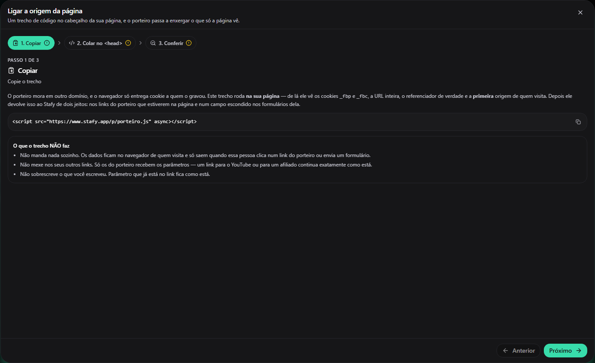

# Formulário da página → captura de leads do Stafy

O formulário da página continua sendo o da página: o mesmo visual, a mesma validação e o mesmo botão.
Quando a pessoa envia, os dados vão **só para o Stafy** — para o formulário **"Black IBPROF — Grupo
VIP"** do negócio **IBPROF**, que é a captura de leads do Stafy. Junto vai **toda a origem dela**: as
UTMs, o `fbclid`, o `gclid`, os cookies `_fbp` e `_fbc` da Meta, a página, o referenciador e o clique do
porteiro. Depois ela segue para a página de obrigado (`obrigado.html`).

```
pessoa preenche ──► index.html valida ──► integracoes/stafy-formulario.js ──► POST no Stafy
     │                                   (junta a origem do porteiro.js)      /api/forms/black-ibprof-grupo-vip/submit?negocio=ibprof
     │                                                                              │
     └── fbq('track','Lead', …, {eventID})                                          ▼
         (o Pixel da página)              o Stafy grava o contato + os campos ocultos
                  │                       e manda o MESMO Lead pela API de Conversões
                  └──────── a Meta junta os dois pelo id e conta UM Lead ◄──────────┘

                         obrigado.html?<as mesmas UTMs>  ◄── resposta ok
```

**Não há mais planilha do Google.** Em 14/10/2026 o Paulo pediu: *"ele não tem que ir pra uma
planilha, ele tem que ir para a captura de leads"*. A cópia para o Google Sheets saiu do `index.html`, e
os arquivos dela (`planilha-leads.gs`, `COMO-CONFIGURAR-A-PLANILHA.md`) saíram do repositório (estão no
histórico do git, se um dia precisar).

---

## 1. No Stafy: o formulário já existe

O formulário foi criado no Stafy pela **migração 0305** (`packages/db/src/migrations/0305_o_formulario_da_black_ibprof_grupo_vip.sql`):

| | |
| --- | --- |
| Negócio | **IBPROF** (`ibprof`) |
| Formulário | **Black IBPROF — Grupo VIP** (`black-ibprof-grupo-vip`) |
| Endereço de integração | `https://www.stafy.app/api/forms/black-ibprof-grupo-vip/submit?negocio=ibprof` |
| Campos | Nome (`name`), E-mail (`email`), WhatsApp (`phone`) — os três obrigatórios |
| Campos ocultos | **todos ligados** (ver o item 1.1) |
| Lead na Meta (API de Conversões) | ligado no pixel desta página (`1456216939376794`), com o token da conexão da Meta do IBPROF |

Para ver e mudar: no Stafy, escolha o negócio IBPROF no seletor do cabeçalho → **Contatos ›
Formulários** → **Black IBPROF — Grupo VIP**. O editor tem **seis passos**:

| Passo | O que tem |
| --- | --- |
| **1 · O que a pessoa preenche** | os 3 campos da página. Não precisa criar campo nenhum |
| **2 · Campos ocultos** | o que o formulário capta sem a pessoa ver — um interruptor por item (item 1.1) |
| **3 · Para onde vai depois** | **em branco**: quem manda a pessoa para o obrigado é a página (`CONFIG.paginaObrigado`) |
| **4 · O que acontece ao receber** | lista, tags, funil do CRM, WhatsApp ao receber, o seu webhook e o **Lead na Meta** (item 1.2). Para separar estes leads, ponha uma **tag automática** (ex.: `black-ibprof-grupo-vip`) |
| **5 · Onde publicar** | em **"Já tenho um formulário na minha página"** está o endereço de integração (o mesmo da tabela acima). ⚠️ **Não** use o "Código para colar no seu site": ele troca o formulário da página pelo do Stafy |
| **6 · Conferir** | o resumo: os campos, quantos campos ocultos estão ligados e o que acontece ao receber |

**Os campos: a página manda, o Stafy recebe**

| Campo na página (`name` do HTML) | O que a página envia | Chave no Stafy | O que vira no Stafy |
| --- | --- | --- | --- |
| `nome` | `name` | `name` | o nome do contato |
| `email` | `email` | `email` | o e-mail do contato |
| `whatsapp` | `phone` (com 55 na frente: `5545999990000`) | `phone` | o WhatsApp do contato, o card do CRM e quem recebe o disparo |

- **Não crie campo para UTM, `fbclid`, `gclid`, `_fbp` nem `_fbc`.** Esses são os **campos ocultos que o
  Stafy já capta sozinho** (item 1.1).
- O Stafy aceita o cadastro que tiver **e-mail OU WhatsApp**. Telefone repetido, como `(11) 11111-1111`,
  é recusado.
- Se a página ganhar um campo novo (ex.: "Você já é professor?"), crie no passo 1 um campo com a **chave
  igual ao `name` do HTML** (ex.: `ja_e_professor`) e escolha a variável do contato onde ele guarda — uma
  que já existe ou uma nova. O Stafy **não deixa nascer duas variáveis com o mesmo nome** ("Cidade natal",
  "cidades natais" e "cidadenatal" são a mesma): ao digitar um nome que já existe, a opção é "Usar … — ela
  já existe". No `index.html`, acrescente o campo em `campos: {…}` na chamada do envio.

### 1.1 Os campos ocultos — o que o formulário capta sem a pessoa ver

É o passo **2 · Campos ocultos** do editor, como os campos ocultos do ActiveCampaign. Cada item tem um
interruptor, o nome, a chave técnica, **o que é** e **de onde vem**; cada grupo diz **onde fica gravado**.
Ligado, o Stafy capta e grava; **desligado, o dado não é gravado em lugar nenhum** (nem na ficha, nem no
webhook de saída, nem na Meta) — mesmo que a página mande.

| Grupo | Os campos | De onde vem | Onde fica no Stafy |
| --- | --- | --- | --- |
| **UTMs da campanha** | `utm_source`, `utm_medium`, `utm_campaign`, `utm_content`, `utm_term` e as outras (`utm_id`, `utm_placement`, `hsa_*`) | o link do anúncio, o link do porteiro ou o `porteiro.js` desta página | a ficha do contato (Histórico de origem, "Entrou por"), a captura e o envio na linha do tempo |
| **Clique do anúncio** | `fbclid` (FB click), `_fbc`, `_fbp`, `gclid`, ids do anúncio (`ad_id`, `adset_id`, `campaign_id`), `src` | a URL (`?fbclid=`…) e os cookies da Meta desta página, lidos pelo `porteiro.js`. **Sem o cookie `_fbc`, o Stafy o monta pelo `fbclid`** (`fb.1.<hora do clique>.<fbclid>`, como a Meta ensina) | a captura (`fbclid`, `fbp`, `fbc`), o Histórico de origem — e vão no Lead da API de Conversões |
| **A página e o caminho** | o clique no link do porteiro (`?pc=`), a página, de onde chegou (referrer), a **primeira** e a **última** origem | o `?pc=` da URL, o endereço desta página, o `document.referrer` e o `porteiro.js` (que guarda a primeira visita da pessoa) | o Histórico de origem (a página, a primeira origem, o protocolo) |
| **Localização (Cloudflare)** | país, estado (UF), cidade, CEP, coordenadas, fuso horário, continente, operadora | a **Cloudflare**, pelo endereço de internet da pessoa, sem pedir nada a ela | a captura (país, UF, cidade) e o Histórico de origem (o resto) |
| **Aparelho e conexão** | IP, aparelho e sistema, navegador | o navegador da pessoa (a Cloudflare entrega o IP de verdade) | a captura e o envio |

**A geolocalização da Cloudflare não pede nada novo**: o endereço `www.stafy.app/api/forms/*` já passa
pela borda do Stafy (o Worker da Cloudflare que entrega a cidade, o estado e as coordenadas ao
servidor). Ela vale quando quem envia é o **navegador da pessoa** — e é o caso desta página (o `fetch`
sai do navegador). Um sistema que postasse pelo servidor dele chegaria sem localização, de propósito
(seria a cidade do servidor, não a da pessoa).

**Onde ver na ficha do contato**: cada envio grava o **retrato dos campos ocultos** (o que foi captado,
campo a campo) no envio do formulário e no evento "Formulário enviado" da linha do tempo do contato
(no detalhe do evento). As colunas de sempre (UTMs, cidade, `fbclid`, `fbp`/`fbc`, aparelho) seguem na
captura e no Histórico de origem. O webhook de saída do formulário, se ligado, leva o retrato em
`ocultos`.

### 1.2 O Lead pela API de Conversões da Meta

No passo **4 · O que acontece ao receber**, a seção **"Lead na Meta (API de Conversões)"**: a cada
envio, o Stafy manda o evento **Lead** também pelo **servidor** — ele chega mesmo com bloqueador de
anúncio ou no Safari, que derrubam o Pixel do navegador. Vai: o e-mail e o telefone em **SHA-256** (nunca
em texto), os cookies `_fbp` e `_fbc`, o IP e o navegador — só o que os campos ocultos deixam captar.

**Sem contar em dobro:** esta página dispara o Pixel (`fbq('track','Lead')`) **e** o Stafy manda o
mesmo Lead pelo servidor. A Meta junta os dois e conta **um** porque os dois levam o **mesmo id**: a
página gera um id (`StafyFormulario.novoIdDoLead()`), usa no `fbq(…, {eventID: id})` e manda o mesmo no
envio (`stafy_evento_id`). O Stafy usa esse id no evento do servidor e o devolve na resposta
(`evento_id`).

---

## 2. Na página (este repositório)

### 2.1 O `CONFIG` do `index.html`

```js
stafy: {
  endereco: 'https://www.stafy.app/api/forms/black-ibprof-grupo-vip/submit?negocio=ibprof',
  usarDestinoDoStafy: false,
  prazoMs: 8000
},
paginaObrigado: 'obrigado.html'
```

| Chave | O que é |
| --- | --- |
| `stafy.endereco` | o endereço do formulário no Stafy (o da tabela do item 1). Com `''`, o envio ao Stafy fica desligado |
| `stafy.usarDestinoDoStafy` | `false` (padrão): depois do envio, a pessoa vai para `paginaObrigado`. `true`: vai para o destino do passo 3 do Stafy, se houver, já com as UTMs, o `src`, o `fbclid` e o `gclid` |
| `stafy.prazoMs` | quanto a página espera o Stafy responder. Passou disso, a pessoa segue para o obrigado e o pedido termina sozinho em segundo plano (`keepalive`) |
| `paginaObrigado` | para onde a pessoa vai depois. A página leva junto a busca da URL (`?utm_source=…`) |

### 2.2 O que é enviado ao Stafy

O mesmo formato do formulário nativo do Stafy:

| No corpo | De onde vem | Para que serve no Stafy |
| --- | --- | --- |
| `name`, `email`, `phone` | o que a pessoa digitou | o contato (sem duplicar: acha a pessoa pelo telefone ou e-mail, inclusive quem já conversou no WhatsApp) |
| `utm_source` … `utm_term` | a URL da página | os campos ocultos de UTM |
| `pc` (e `?pc=` no endereço) | a URL, quando a pessoa veio por um link do porteiro | costura o cadastro ao clique (cidade, aparelho, protocolo) |
| `stafy_params` | **todos** os parâmetros da URL (`fbclid`, `gclid`, `src`, `ad_id`…) | os campos ocultos de clique; parâmetro desconhecido (ex.: `?turma=a`) **vira coluna no contato** |
| `stafy_pagina` | o endereço desta página | a página (e o `event_source_url` do Lead na Meta) |
| `stafy_referrer` | `document.referrer` | de onde a pessoa veio (ex.: `l.facebook.com`) |
| `stafy_origem` | o **pacote da origem**, em **texto JSON**: o do `porteiro.js` (primeira + última origem) ou, se ele não carregou, um pacote mínimo | a primeira e a última origem e os cookies **`_fbp` e `_fbc`** |
| `stafy_evento_id` | o id do Lead (o mesmo do `eventID` do `fbq`) | o `event_id` do Lead pela API de Conversões — a Meta não conta duas vezes |

O pedido vai como **`text/plain`** com JSON dentro: o navegador não faz a pergunta prévia de CORS
(`OPTIONS`), e o envio fica com uma ida a menos ao servidor. O Stafy lê como JSON todo corpo que não é
de formulário.

### 2.3 O que a página faz com cada resposta

| Resposta do Stafy | O que a pessoa vê |
| --- | --- |
| **200** `{ ok: true, evento_id }` | vai para o obrigado (ou para o destino do Stafy, com `usarDestinoDoStafy: true`) |
| **422** `phone_invalid` | "Confira o seu WhatsApp com DDD — esse número não parece válido." O botão volta e ela corrige |
| **422** `email_required` | "Digite um e-mail válido." |
| **429** (muitas tentativas do mesmo IP) | "Muitas tentativas seguidas. Espere um minuto e tente de novo." |
| **404**, **500**, sem rede, ou passou de `prazoMs` | **segue para o obrigado mesmo assim** — travar a pessoa perderia o lead de vez, e o pedido continua em segundo plano (`keepalive`). No console do navegador aparece `[Stafy] o cadastro não chegou ao Stafy: <motivo>`. ⚠️ Sem a planilha, um cadastro que o Stafy não recebeu (fora do ar) não fica guardado em outro lugar |

Antes de chegar ao Stafy, a página confere tudo sozinha: nome com 2 letras ou mais, e-mail válido e
WhatsApp com DDD (10 ou 11 dígitos). Durante o envio, o botão fica desabilitado e mostra "Enviando...".

### 2.4 Os arquivos

| Arquivo | O que tem |
| --- | --- |
| `index.html` | o `<script>` do porteiro no `<head>`, o Pixel da Meta, o `CONFIG.stafy` e o envio dos dois formulários (o do topo e o do fim) |
| `integracoes/stafy-formulario.js` | o envio para o Stafy (e o `novoIdDoLead()`). Serve para **qualquer outra página**: inclua o arquivo e chame `StafyFormulario.enviar({ endereco, campos, idDoEvento })` |
| `integracoes/teste/servidor-de-teste.mjs` | um Stafy de mentira para testar na máquina, sem enviar nada para lugar nenhum |
| `integracoes/prints/` | os prints (item 5) |

---

## 3. O que o Stafy faz com o cadastro

O mesmo caminho do formulário nativo (`src/lib/forms/receber-o-envio.ts` no Stafy):

- **contato**: acha a pessoa sem duplicar (telefone → e-mail), inclusive quem já conversou pelo
  WhatsApp. Grava nome, e-mail e WhatsApp (com o DDI);
- **campos ocultos**: grava cada um que estiver ligado (item 1.1) na captura, no Histórico de origem e
  no retrato do envio;
- **automação**: a lista e as tags do passo 4; o evento **`form_submitted`**, que começa os fluxos de
  "Formulário — Submetido"; o `tag_added`, que liga as automações por tag; e, se ligados, o card no
  CRM, o WhatsApp ao receber e o webhook de saída;
- **Meta**: o Lead pela API de Conversões, com o mesmo id do Pixel (item 1.2).

---

## 4. Como testar

### 4.1 Na máquina, sem tocar no Stafy

```bash
node integracoes/teste/servidor-de-teste.mjs
```

Abra `http://localhost:5500/?utm_source=facebook&utm_campaign=teste&fbclid=IwAR_teste` e envie o
formulário. O terminal mostra **o corpo exato** que o Stafy receberia (com o `stafy_evento_id`), já
conferido com as regras dele. O servidor troca na hora o Stafy e o Pixel por versões locais, então nada
sai da máquina.

- WhatsApp `(11) 11111-1111` → o Stafy de mentira responde 422 (testa a mensagem de erro);
- `MODO=fora` (500), `MODO=lento` (15 s) e `MODO=limite` (429) testam os outros caminhos;
- `PORTEIRO_JS=<arquivo>` serve um `porteiro.js` local. Sem ele, a página usa o pacote mínimo de origem.

### 4.2 De verdade, com o Stafy

1. Publique a página.
2. Abra a página publicada com `?utm_source=teste&utm_campaign=teste-integracao&fbclid=teste123` e envie
   com os seus dados.
3. No Stafy, abra o contato (Contatos): a origem **"formulário"** aparece com as UTMs; no evento
   "Formulário enviado" da linha do tempo estão os campos ocultos captados. No console do navegador, não
   deve haver aviso `[Stafy]`.
4. No Gerenciador de Eventos da Meta (pixel `1456216939376794`), o Lead aparece com as duas fontes
   (navegador e servidor) **desduplicadas**.

### 4.3 O que já foi provado (14/10/2026)

- **A página** (Chromium contra o servidor de teste, nada saiu da máquina): o envio vai para
  `black-ibprof-grupo-vip` com `?negocio=ibprof`, leva o `stafy_evento_id`, passa nas regras do Stafy,
  sem pergunta prévia de CORS e **sem nenhum pedido à planilha do Google**; o Pixel dispara o Lead com o
  `eventID` **igual** ao `stafy_evento_id`; a pessoa vai para o obrigado com as UTMs (12 de 12).
- **O Stafy** (banco local e a Meta de mentira): o envio grava cada campo oculto ligado — inclusive a
  localização da borda da Cloudflare e o `_fbc` montado do `fbclid` —, não grava os desligados em lugar
  nenhum, e manda o Lead à Meta com o MESMO id da página e o e-mail em SHA-256. Na tela: o passo "Campos
  ocultos" com os 28 itens, desligar grava sozinho, o envio de verdade pela página pública (41 de 41).
- **A migração** que cria o formulário passou no ensaio contra a produção (nada gravado).

**O que NÃO foi provado:** o envio para o Stafy de produção (depende de a migração 0305 ser aplicada e
de a página ser publicada) e o Lead chegando à Meta de verdade (depende de o token da conexão do IBPROF
ter acesso a este pixel).

---

## 5. Prints

**Da página** (tirados no teste, com dados de mentira):

| | |
| --- | --- |
|  |  |
| O formulário do topo, preenchido | "Enviando...": o botão travado enquanto o Stafy responde |
|  | |
| O Stafy recusou o telefone (422): mensagem em português e o botão de volta | |

**Do Stafy** (tirados no Stafy local, com um negócio de prova):

1. **Formulários do negócio**: 
2. **O passo "Campos ocultos"** — os grupos, o interruptor de cada item, o que é e de onde vem:

   

3. **A localização da Cloudflare**, no mesmo passo:

   

4. **O Lead na Meta** (passo "O que acontece ao receber"):

   

5. **O endereço de integração** (passo "Onde publicar" › "Já tenho um formulário na minha página"):

   

6. **Porteiro › "Ligar a origem da página"** — o mesmo script que está no `<head>` do `index.html`:

   

---

## 6. Os limites conhecidos

- **Sem planilha, sem reserva**: se o Stafy estiver fora do ar no momento do envio (e o `keepalive` não
  conseguir entregar depois), o cadastro não fica em lugar nenhum — a pessoa segue para o obrigado e o
  grupo, mas não vira contato. O Stafy responde em menos de 1 s no normal.
- **O token do Lead na Meta** é o da conexão da Meta do IBPROF. Se ele não tiver acesso a este pixel, o
  Lead pelo servidor é recusado pela Meta (o Pixel do navegador continua). O Stafy registra o motivo no
  log do servidor (`[lead-do-formulario] … a Meta não aceitou`). Para trocar: passo 4 → "Lead na Meta" →
  escolha outro token ou cole um do Gerenciador de Eventos.
- **O negócio no endereço (`?negocio=ibprof`) é obrigatório na prática**: o nome do formulário só é único
  dentro do negócio.
- **Limite de envios**: o Stafy limita por formulário e por IP (e o Lead na Meta tem teto de 30 por minuto
  por endereço). Num evento com muita gente na mesma rede, algumas pessoas podem ver "muitas tentativas".

## 7. Outros jeitos de integrar depois

- **O formulário do Stafy dentro da página** (passo 5, "Código para colar no seu site"): o Stafy desenha
  o formulário, e o visual passa a ser o dele.
- **HTML puro, sem JavaScript** (passo 5, "HTML para colar na sua landing page"): um
  `<form action="…/submit?negocio=…" method="POST">`. O Stafy responde com um redirecionamento (303)
  para o destino do passo 3.
- **Por MCP** (passo 5, "Ligar por MCP"): o Claude, o ChatGPT ou um agente cadastra pelo conector, pelo
  mesmo caminho (o Lead na Meta não sai por ali: o servidor da IA não é o navegador de ninguém).
- **Outra página**: copie `integracoes/stafy-formulario.js`, ponha o `porteiro.js` no `<head>` e chame
  `StafyFormulario.enviar({ endereco, campos: { name, email, phone }, idDoEvento })`.
